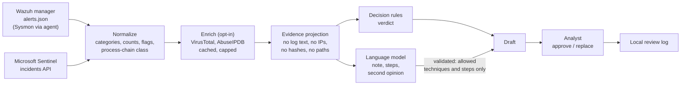

# AI-assisted alert triage

A Python CLI and local dashboard that triages Wazuh and Microsoft Sentinel alerts. **Decision rules set the verdict; a language model writes the triage note, picks investigation steps and gives a second opinion** that is flagged when it disagrees. An analyst approves or replaces every verdict. The tool makes no SIEM changes.

Verified on macOS with a Windows 11 ARM endpoint in UTM. Wazuh collected a Sysmon alert for PowerShell launching SecEdit. The dashboard rules and local Qwen model both returned `needs_review`. [Windows endpoint results](docs/LAB.md#windows-endpoint-results)

## How it works



**Why the model doesn't decide.** Its input is a schema projection with no free text, so log lines can't carry prompt injection. That also means it sees the same facts as the rules, so for the verdict, explicit rules are more reliable and easier to audit. The model adds value where rules are weak: weighing combinations of weak signals, writing a readable note, and ordering the investigation steps. Its own verdict is kept as a second opinion, and the benchmark measures how often it catches cases the rules miss versus how often it would mislead.

## Run locally

Python 3.10+ with the standard library is enough. From this directory:

```sh
python3 dashboard_server.py
```

Open the printed loopback URL. Switch the alert source between the synthetic queue and the local Wazuh manager, filter alerts, inspect evidence, and explicitly approve a verdict. Decision rules draft the verdict for every alert. **Generate draft** adds the local Ollama model's note, investigation steps and second opinion (`TRIAGE_DASHBOARD_MODEL`, see below), and you can opt into public indicator lookups for an individual Wazuh alert. Approved verdicts are saved locally in `reviews/dashboard.sqlite3`. The Benchmarks view shows recorded verdict accuracy and draft latency. Use the CLI below to collect and compare paired analyst timings.

### Command-line tools

```sh
python3 -m unittest discover -s tests
python3 cli.py benchmark
mkdir -p reviews
python3 cli.py review --source wazuh --alerts fixtures/wazuh_sample.jsonl \
  --mode assisted --engine baseline --output reviews/wazuh-demo.jsonl
```

The included Wazuh sample is synthetic. Swap in a copied manager export when available. `--engine baseline` uses the decision rules alone, `--engine hybrid` adds the model note and second opinion, and `--engine ollama` / `--engine llm` let the model decide alone for comparison. Use `--engine llm --model "$TRIAGE_MODEL"` with an OpenAI chat model that supports JSON output and an `OPENAI_API_KEY` in the environment. Model calls may incur charges. For the hybrid engine with OpenAI, add `--provider openai`. Benchmarks accept the same flags. [OpenAI API request options](https://developers.openai.com/api/reference/resources/chat/subresources/completions/methods/create)

## Run against the local Wazuh manager

With the `wazuh` Colima profile and its Wazuh containers running, start Ollama on loopback if it is stopped and pull `qwen3:8b` (about 5 GB; use `qwen3:1.7b` on a machine with 8 GB RAM). Then run:

```sh
python3 cli.py preview --source wazuh-docker --engine hybrid --model qwen3:8b --limit 3
python3 cli.py review --source wazuh-docker --mode assisted --engine hybrid \
  --model qwen3:8b --limit 3 --output reviews/wazuh-local.jsonl
python3 cli.py benchmark --fixtures fixtures/hard_alerts.jsonl --engine hybrid --model qwen3:8b
```

The preview prints pending drafts and records no approvals. Review requires a terminal. Set `--docker-context` and `--wazuh-container` if your local names differ. The Ollama adapter sends the same projected JSON as the OpenAI adapter to `127.0.0.1:11434`, with redirects and HTTP proxies disabled for that local endpoint. [Qwen model](https://ollama.com/library/qwen3)

For Sentinel, set `AZURE_ACCESS_TOKEN` to a short-lived Azure Resource Manager token with read access to the workspace and use:

```sh
python3 cli.py review --source sentinel --subscription "$SUBSCRIPTION_ID" \
  --resource-group "$RESOURCE_GROUP" --workspace "$WORKSPACE" \
  --mode assisted --engine baseline --limit 5 --output reviews/sentinel.jsonl
```

Sentinel retrieves alerts for recent incidents. It uses incident-level indicators only where the incident contains a single alert. Wazuh uses an allowlist of known MITRE rule tags and Sentinel uses exact mappings for known lab rule titles. Unknown mappings remain empty and need analyst review.

## Reputation enrichment

Copy `.env.example` to `.env` in this directory and fill in `VT_API_KEY` and optionally `ABUSEIPDB_API_KEY`. The `.env` file is ignored by Git. Environment variables take precedence, and `VIRUSTOTAL_API_KEY` is also accepted as an alias. Add `--enrich` to a live-source assisted review to enable lookups. VirusTotal receives public IPs and validated file hashes as lookup identifiers. AbuseIPDB receives public IPs. Lookups are cached for the current session and capped at four per provider per invocation by default. Confirm your account quotas and data-sharing rules before enabling lookups. VirusTotal's public API is intended for permitted noncommercial use. [VirusTotal API terms and setup](https://docs.virustotal.com/reference/getting-started) · [AbuseIPDB API](https://docs.abuseipdb.com/)

From a terminal, run `python3 cli.py check-enrichment --provider vt` to test your VirusTotal key against a public IP and a file hash. If the key is absent from both `.env` and the environment, the command asks for it with input hidden. The check does not save a key or upload a file. Use `--provider abuseipdb` for an AbuseIPDB IP lookup check.

## Prompt-injection defense

The model input is a schema projection. Process paths and command lines from Sysmon are reduced locally to a fixed process-chain class (for example `office_to_script`) before anything reaches the model. Log messages, alert descriptions, evidence links, raw IPs, raw hashes, account names, arbitrary fields, and benchmark labels stay out of the model payload. Normalization admits known categories, bounded counts, booleans, and numeric reputation. Model output must pass a second validation step before it can be displayed as a draft. MITRE IDs must come from the mapping candidates supplied for that alert, and investigation steps from a fixed per-category catalog.

The model has no tools, SIEM write access, or authority to record a verdict. Interactive review can approve a draft, replace the verdict, skip it, or quit. Only an explicit decision writes a final verdict to a new local JSONL review file. Run reviews under an authorized analyst's OS account and keep review files out of Git.

## Measure accuracy and analyst time

Two labeled sets:
- `fixtures/labeled_alerts.jsonl`: 50 alerts from 10 scenario families. **The rules score 50/50 here, which shows this set is too easy to be a real test.** It stays as a regression check.
- `fixtures/hard_alerts.jsonl`: 25 harder cases written to break simple rules: conflicting context, a shared VPN egress with a high abuse score, malicious activity made of several weak signals, endpoint attacks with process-chain evidence, and injection text.

Labels on both sets were written by me, the same person who wrote the rules. A second labeler would make the numbers more trustworthy.

| Run | Set | Result |
| --- | --- | --- |
| Decision rules | Original 50 | [50/50](results/baseline-benchmark.json) |
| Decision rules | Hard 25 | [19/25 (76%)](results/baseline-hard-benchmark.json). All 6 misses go to `needs_review`; no malicious case received a benign rules verdict |
| Hybrid with `qwen3:1.7b` | Hard 25 | [Rules 19/25, opinion 10/25 (40%)](results/hybrid-qwen3-1.7b-hard.json). Caught 0 rule misses, challenged 9 correct rule calls. Mean draft time 1.86 s. |
| Hybrid with `qwen3:8b` | Hard 25 | [Rules 19/25, opinion 11/25 (44%)](results/hybrid-qwen3-8b-hard.json). Caught 0 rule misses, challenged 8 correct rule calls. Mean draft time 6.55 s. |
| Previous version: Qwen3 1.7B deciding the verdict alone | Original 50 | [24/50](results/qwen3-1.7b-benchmark.json), recorded before the evidence and rules update |
| Local Wazuh Docker → Ollama | 3 real manager alerts | 3 valid drafts, pending human review (no endpoint agent yet) |

The rule misses on the hard set are the cases the model is there for: a two-day-old admin account signing in from a hosting IP on a new device, an MFA approval after only two denials, a widely detected file launched from Word, and a shared corporate VPN with abuse reports from other tenants.

```sh
python3 cli.py benchmark --fixtures fixtures/hard_alerts.jsonl
python3 cli.py benchmark --fixtures fixtures/hard_alerts.jsonl --engine hybrid --model qwen3:8b
python3 cli.py benchmark --fixtures fixtures/hard_alerts.jsonl --engine hybrid --model qwen3:1.7b
```

Hybrid output adds `assist.model_right_rules_wrong` (cases the second opinion catches), `assist.rules_right_model_wrong` (cases where it would mislead) and `assist.model_accuracy`. Both measured runs completed with Ollama on Apple Silicon. Neither second opinion improved on the rules on this set, and the 8B model took longer. Note quality and investigation-step usefulness were not scored.

### Analyst time

To measure time saved, collect **two independent, blinded reviews** of the same alert IDs, one manual and one assisted. Use different analysts or counterbalance review order and don't expose the labels during review. The timer starts when an analyst opens a case and includes drafting and enrichment in assisted mode.

```sh
python3 cli.py review --source fixture --fixtures fixtures/hard_alerts.jsonl --mode manual \
  --limit 20 --output reviews/manual.jsonl
python3 cli.py review --source fixture --fixtures fixtures/hard_alerts.jsonl --mode assisted \
  --engine hybrid --model qwen3:8b --limit 20 --reverse --output reviews/assisted.jsonl
python3 cli.py metrics --fixtures fixtures/hard_alerts.jsonl \
  --manual reviews/manual.jsonl --assisted reviews/assisted.jsonl
```

No time-saved result is reported until these paired reviews exist.
